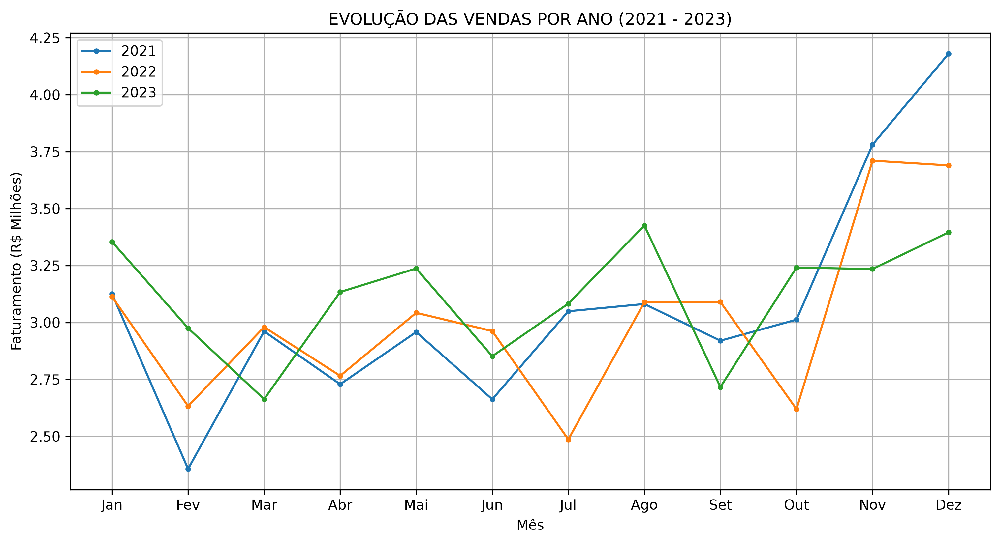
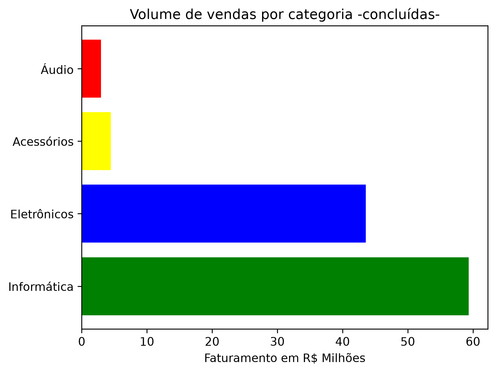
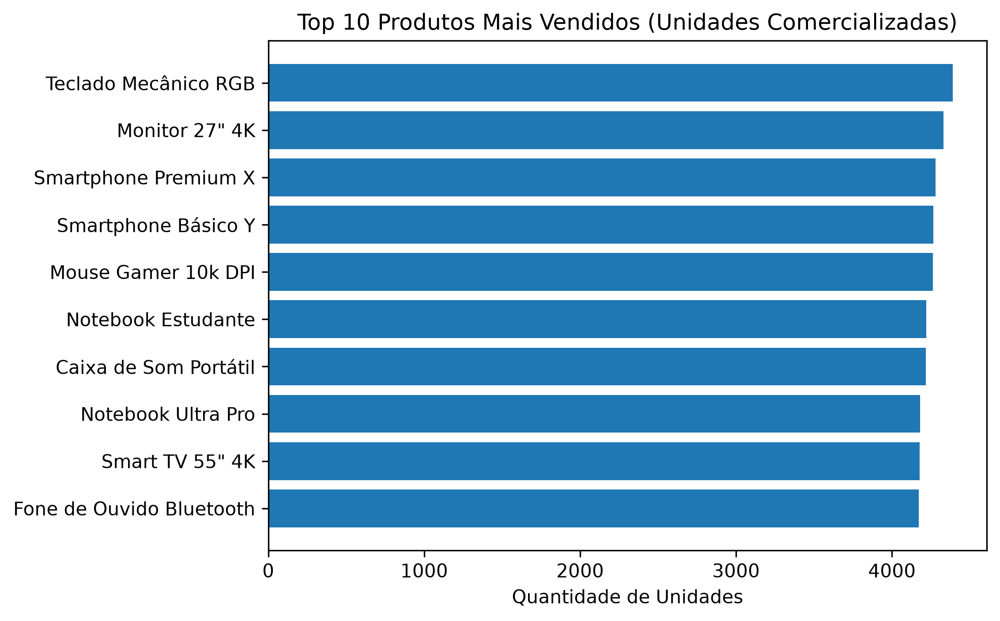

## 📊Estudo Aplicado (Estratégia de Alocação de Orçamento)

### 1. Pergunta de Negócio Investigada
**Como a diretoria deve distribuir o orçamento de marketing e a força de vendas entre categorias de produtos e períodos do ano para maximizar o faturamento líquido, considerando a diferença entre itens de alto giro unitário e categorias de maior receita, além da perda de vendas observada nos meses de dezembro entre 2021 e 2023?**

---

### 2. Descrição Metodológica
Para sustentar a decisão estratégica, realizou-se uma investigação multidimensional a partir da base `vendas.csv` tratada em Python (`pandas` e `matplotlib`):
1. **Tratamento e Padronização:** Remoção de registros duplicados, tratamento de valores ausentes em `cidade_cliente`, conversão de `quantidade` para valores absolutos (`abs()`), padronização de nomenclaturas em `categoria_produto` (`Informatica` → `Informática` e `Eletronicos` → `Eletrônicos`) e conversão temporal de `data_venda`.
2. **Filtro de Receita Realizada:** Isolamento das operações com `status_venda == 'Concluído'` para evitar distorções de faturamento bruto sobre pedidos não efetivados, mensurando o impacto da política de descontos sobre o `valor_total`.
3. **Cruzamento Multidimensional (Categoria × Produto × Tempo):**
   - Comparação entre o **volume de unidades comercializadas** (Top 10 produtos) e a **participação no faturamento líquido por categoria** (`categoria_limpa`).
   - Análise da **evolução anual e sazonalidade mensal** (`ano` e `mes` entre jan/2021 e dez/2023) para identificar deslocamentos nos picos de demanda.

---

### 3. Evidências Numéricas Extraídas do DataFrame

#### A) Consolidado Financeiro (Vendas Concluídas)
| Indicador | Valor Extraído | Observação |
| :--- | :---: | :--- |
| **Faturamento Total Bruto** | R$ 117.627.401,80 | Soma de `quantidade * preco_unitario` |
| **Total de Descontos Concedidos** | R$ 7.325.877,70 | Taxa média de **6,23%** sobre o bruto |
| **Faturamento Total Líquido** | **R$ 110.301.524,10** | Receita efetiva (`valor_total`) |

#### B) Faturamento Líquido por Categoria vs. Volume de Unidades (Top 10)
| Categoria | Faturamento Líquido (R$) | Participação (%) | Destaques no Top 10 em Unidades Vendidas |
| :--- | :---: | :---: | :--- |
| **Informática** | R$ 59.324.153,84 | **53,78%** | Monitor 27" 4K (4.330 un.), Notebook Estudante (4.221 un.), Notebook Ultra Pro (4.179 un.) |
| **Eletrônicos** | R$ 43.549.096,99 | **39,48%** | Smartphone Premium X (4.279 un.), Smartphone Básico Y (4.266 un.), Smart TV 55" 4K (4.177 un.) |
| **Acessórios** | R$ 4.477.086,49 | **4,06%** | **Teclado Mecânico RGB (4.389 un. — 1º geral)**, Mouse Gamer 10k DPI (4.262 un.) |
| **Áudio** | R$ 2.951.186,78 | **2,68%** | Caixa de Som Portátil (4.218 un.), Fone de Ouvido Bluetooth (4.172 un.) |

- **Diagnóstico de Mix:** **Informática e Eletrônicos concentram 93,27%** do faturamento líquido, enquanto **Acessórios e Áudio somam apenas 6,73%**, mesmo liderando ou empatando em volume físico de unidades no Top 10.

#### C) Evolução Anual e Sazonalidade de Fim de Ano (2021–2023)
| Período | Faturamento Líquido Anual | Variação Anual | Faturamento em Novembro | Faturamento em Dezembro |
| :--- | :---: | :---: | :---: | :---: |
| **2021** | R$ 36.814.175,96 | Base | R$ 3,78 mi (`3.780032`) | **R$ 4,18 mi (`4.179356` — Topo histórico)** |
| **2022** | R$ 36.179.139,79 | -1,72% | R$ 3,71 mi (`3.709859`) | R$ 3,69 mi (`3.689253`) |
| **2023** | **R$ 37.308.208,35** | **+3,12%** | R$ 3,23 mi (`3.234472`) | **R$ 3,40 mi (`3.395337`)** |

- **Diagnóstico Temporal:** Embora 2023 tenha atingido o maior faturamento anual da série (+3,12% sobre 2022), **as vendas de dezembro caíram 18,76% entre 2021 e 2023** (e -7,97% frente a 2022), perdendo o posto de melhor mês do ano em 2023 para **agosto (R$ 3,43 milhões)**. Novembro também recuou **14,43%** no mesmo comparativo (2021 vs. 2023), mostrando perda de força no último trimestre compensada por meses intermediários (agosto, janeiro, outubro e maio de 2023).

---

### 4. Visualizações de Dados

> **Evolução Mensal por Ano (2021–2023):** Evidencia o pico histórico de dezembro/2021 (R$ 4,18 mi), a retração progressiva dos meses de novembro e dezembro em 2022 e 2023, e o crescimento de meses intermediários como agosto/2023 (R$ 3,43 mi).

> **Faturamento por Categoria vs. Volume de Produtos:** Demonstra o contraste entre o domínio financeiro de Informática e Eletrônicos (93,27% da receita) e a alta saída unitária de Acessórios e Áudio (liderados pelo Teclado Mecânico RGB com 4.389 unidades).

---

### 5. Conclusão Executiva e Recomendação Estratégica
Com base nas evidências extraídas, recomenda-se que a diretoria concentre a maior fatia do orçamento de marketing nos **meses de maior fluxo sazonal — com foco prioritário na retomada de dezembro** — combinando uma estratégia regionalizada de mix de produtos: **priorização de itens de mais baixo custo para aumentar o giro e o fluxo de vendas nas regiões Nordeste e Centro-Oeste**, e **adição de produtos de menor custo junto aos itens mais vendidos (venda combinada) nas regiões Sul e Sudeste**. A série temporal de 2021 a 2023 demonstra que, embora o faturamento anual tenha alcançado R\$ 37,31 milhões em 2023 (+3,12% sobre 2022), o mês de dezembro vem perdendo tração ano após ano — acumulando uma queda de **18,76%** desde o pico histórico de dezembro/2021 (de R\$ 4,18 milhões para R\$ 3,40 milhões em 2023) —, o que torna estratégico direcionar verba de marketing para os períodos de maior fluxo a fim de reverter essa retração. No recorte de portfólio e atuação regional, o contraste entre o alto volume físico de periféricos — liderados pelo Teclado Mecânico RGB (4.389 unidades) e pelo Mouse Gamer 10k DPI (4.262 unidades) — e a concentração de 93,27% da receita líquida em Informática (53,78%) e Eletrônicos (39,48%) orienta duas frentes complementares: nas regiões **Nordeste e Centro-Oeste**, apostar em produtos de menor custo reduz a barreira de compra, acelera o giro e expande a base de vendas em vez de depender exclusivamente de itens caros; já nas regiões **Sul e Sudeste**, acoplar acessórios de baixo custo aos produtos principais (como notebook + teclado) aproveita o fluxo consolidado de alto ticket para elevar a conversão e a receita por pedido, preservando a taxa média de desconto controlada em 6,23%.
